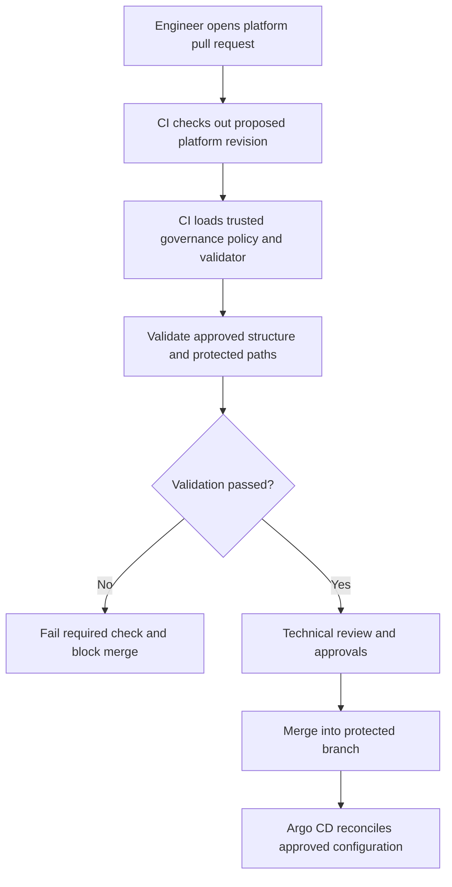
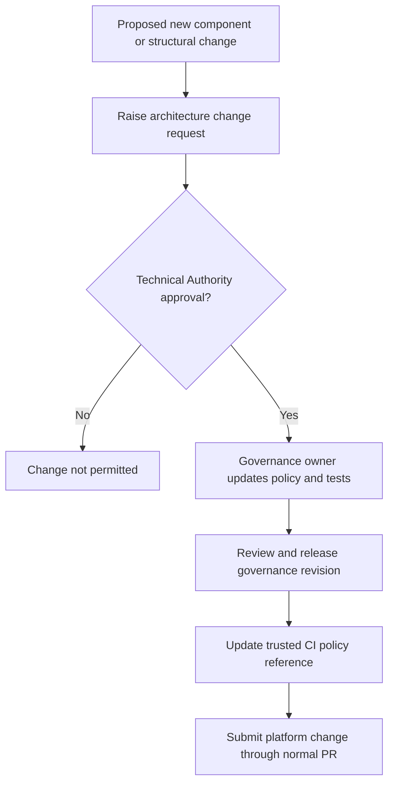

# Hub Cluster Management — Repository Governance

## Purpose

This repository holds the **authoritative structural governance policy and validation tooling** for the OpenShift cluster-platform Git repository. Its initial objective is to prevent unapproved changes to the agreed repository hierarchy, component catalogue, and cluster roles.

This repository **does not deploy OpenShift resources**. It supplies checks to the platform repository's pull-request CI pipeline.

## Repository layout

```text
hub-cluster-management-governance/
├── README.md
├── policies/
│   └── repository-structure/
│       └── approved-components.yaml
├── scripts/
│   └── validate-structure.py
└── tests/
    ├── valid/
    └── invalid/
```

The policy, validator and test fixtures shown above are **planned deliverables**; the README alone does not implement enforcement.

## Governance rules

1. The approved platform repository structure is the baseline. Its mandatory directories and Kustomize entry points must be preserved.
2. Existing approved components may be updated through the normal pull-request process.
3. Introducing a new component family, storage technology, operator family, site, cluster role or top-level directory requires architectural approval.
4. The validator must inspect tracked paths and the relevant manifest content; merely checking directory names cannot detect an unapproved technology hidden inside an approved directory.
5. The authoritative policy and validator must be maintained under restricted governance ownership, independently of ordinary platform contributors.
6. A passing validation build and required reviewers must be enforced by branch protection or repository rulesets on the platform repository.

## Examples

**Permitted structural location** — An engineer updates an approved Hitachi storage component:

```text
gitops/components/storage/hitachi/storageclass-gold.yaml
```

The directory is permitted, but manifest validity and technical approval remain separate requirements.

**Rejected structural change** — An engineer creates an unapproved ODF component:

```text
gitops/components/storage/odf/kustomization.yaml
```

The structure validator should fail with a message identifying the unapproved component. Introducing ODF requires an architecture change and an approved policy update before the platform pull request can pass.

## Pull-request validation workflow



The platform CI workflow must use an **approved, pinned governance revision**, not a validator or policy supplied by the pull request being assessed. CI credentials should be read-only for this repository.

## Architectural change workflow



## Running validation

Once the validator and policy have been implemented, the intended command is:

```bash
python3 scripts/validate-structure.py \
  --repository /path/to/cluster-platform \
  --policy policies/repository-structure/approved-components.yaml
```

Expected contract: exit code `0` on success; non-zero on a structural violation or validation error. CI must fail closed if the governance policy cannot be retrieved or executed.

## Initial acceptance tests

| Test | Expected result |
|---|---|
| Modify YAML inside an approved component | Structural validation passes |
| Add `gitops/components/storage/odf/` | Validation fails |
| Add an unapproved top-level directory | Validation fails |
| Remove a mandatory cluster `kustomization.yaml` | Validation fails |
| Change protected governance rules via a platform PR | Cannot alter trusted CI validation |
| Submit a failing platform PR | Required check prevents merge |
| Push directly to protected `main` as an ordinary contributor | Denied |

## Responsibilities

| Role | Responsibility |
|---|---|
| Platform Architecture / Technical Authority | Owns approved structure and authorises architectural changes |
| Platform Engineering | Maintains OpenShift configuration within approved boundaries |
| CI/DevOps | Implements and operates validators and PR checks |
| GitHub administrators | Configure repository permissions, branch protection and required checks |

## Implementation sequence

1. Commit the approved platform skeleton and record the baseline commit.
2. Implement `approved-components.yaml` for the complete approved hierarchy.
3. Implement `validate-structure.py` and positive/negative tests.
4. Protect governance changes and publish an approved governance revision.
5. Configure the platform repository's GitHub Actions workflow to run the trusted validator.
6. Require a passing validation status and reviewers before merging into `main`.
7. Prove enforcement with a pull request that attempts to add `gitops/components/storage/odf/`.

## Scope and limitations

The first release covers **structural integrity**. Subsequent checks should validate Kustomize rendering, Kubernetes/OpenShift schemas, secrets, manifest content and the intended target-cluster scope.

GitHub does not automatically interpret this README or `approved-components.yaml`. Enforcement exists only after the validation code, CI execution and required merge checks have been configured and tested.
